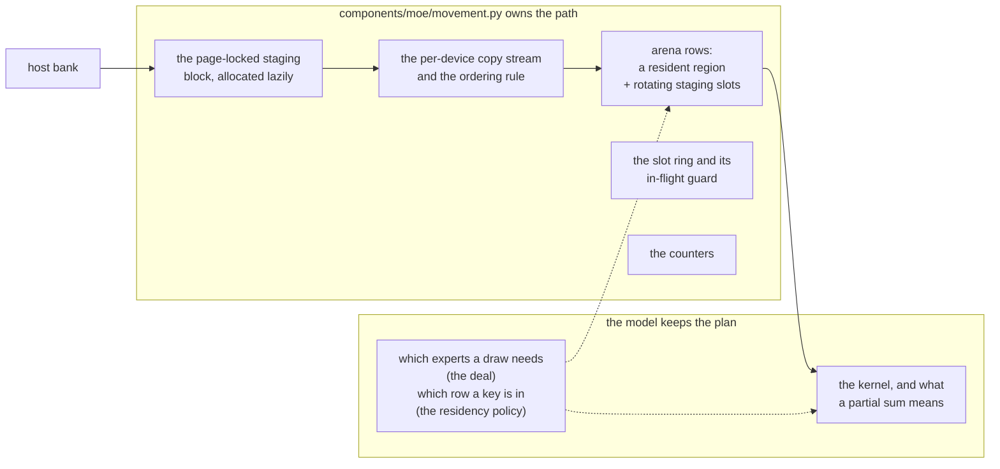

# The expert movement layer

Every runtime in this tree that serves an MoE model is, at its hot spot, moving routed experts from
host memory to the card. That movement is the tree's only real performance centre and the only place
where **adding a model adds another copy of the same code**: the MoE placement and movement
implementations come to 10.5k lines across six places.

Two of those six are a container boundary and are fine. A GGUF checkpoint and a safetensors
checkpoint genuinely differ in how a quantized expert is laid out and read, and the GGUF side's
3,181 lines are the product of that boundary: `components/moe/cpu_backend.py` (1,832),
`gpu_prefill_backend.py` (901), `shared_weights.py` (318) and `ipc.py` (130). What is *not* a
container fact is everything else about the movement — where an expert's bytes wait, when they are
page-locked, which copy stream carries them, when a resident row is evicted — and today the
safetensors side writes that three times over:

| implementation | lines | its own |
| --- | --- | --- |
| `models/deepseek_v4_1/device_experts.py` | 1,888 | arena + resident set + LRU pool + two-buffer ring + chunked bands |
| `models/mimo_v2/device_experts.py` | 882 | arena + resident set + slot ring + chunk bands |
| `models/qwen4_exp/moe.py` | 501 | device tensor cache + prefetch on a copy stream + grouped prefill |

This page is the seam for pulling that out, written before the code because the repository's own rule
is to say what the boundary is before moving anything across it. It is the landing point the
architecture review named: `deepseek_v4_1`, whose model-side MoE is the largest of the three, is the
chosen adaptation target, and is the one of the three with a recorded decode and prefill-8k baseline
in `tests/fixtures/perf/baseline.json`.

## The decision is already shared; the movement is not

`components/moe/placement.py` is where the *capacity* arithmetic lives — `HardwareProfile`,
`usable_per_card`, `context_batch_curve` — and it is imported by three model specs and by triage's
fit check. Six implementations of the movement and one implementation of the decision is not an
accident: a decision is a function of numbers, and a movement is a loop over tensors whose shape
follows from the model.

That asymmetry is exactly what a shared layer has to preserve. What is shared is the *lifecycle* of
the bytes; what stays with the model is *which* bytes and *why*.

## What the movement layer owns

The four things the review listed — where an expert lives, when it is pinned, how it is staged, when
it is evicted — resolve into two owners, and the split is the whole of the design:

Concretely, the shared component owns:

- **The arena.** One `uint8` tensor per `(projection, kind)` a checkpoint declares, `rows` deep, on
  one device, sliced into a resident region in front and rotating staging slots behind it. One
  allocation rather than one a region, because the kernel is handed one tensor and indexes its first
  axis, so a resident row and a staging row have to be rows of the same tensor for one call to read
  both. Byte accounting comes with it.
- **The slot ring.** Round-robin over the slots, with a per-slot event and the rule that a slot is
  not reused until the DMA that last filled it has drained. The rotation advances only on rows that
  actually move bytes — a row the resident set answered in full must not consume a slot, or the
  guarantee that a slot's copy was issued a whole working row ago stops holding.
- **The copy stream and its ordering rule.** One H2D stream per device, and the two waits that make
  it correct: the copy stream waits on the compute stream before it overwrites rows a kernel may
  still be reading, and the compute stream waits on the copy stream before the kernel that reads the
  rows just written. Nothing on the host waits for either.
- **The page-locked staging block**, allocated on first use and never for a run that never fills.
- **The counters**, because "how much did the bank save" is a question about copies and not about
  the wall clock, and because the recorded measurements on the performance pages are read off these
  fields by name.

## What stays with the model

The model keeps the plan: which experts a draw needs (the deal), which arena row a key occupies
(the residency policy), what the kernel call is, and what a returned partial sum means.

Those are not incidental. This repository has already rejected one version of the opposite idea.
`docs/architecture/one_scheduler_many_models.md` records a per-architecture `ServingSpec` carrying
seven methods, and rejects it as *the adapter duplication this tree already suffers, moved one level
up and given a better name*. A shared movement layer that also took the arithmetic would be the same
mistake in a smaller costume, because the three banks do not share an arithmetic:

| | v41 | mimo | qwen4_exp |
| --- | --- | --- | --- |
| what the host holds | a registered bank plus a resident Engram table | one POSIX segment per rank, experts in the shard's own order | per-rank expert shards plus a PLE table |
| how a draw is shared | `sorted` / `id`, `deal_card` | `sorted` / `id`, `deal_card` | round-robin `expert % world` |
| residency policy | a per-layer hot set counted over the whole layer's routing, plus an LRU pool keyed `(layer, expert)` | least-frequently-used over the run, per-layer blocks, strictly-hotter to evict | a capacity LRU over `(layer, expert)` |
| the kernel | fp4 single-token and chunked, graph split point | fp4 single-token, grouped chunk | grouped bf16 prefill, fp8 dispatch |

The deal is the clearest case. v41's and mimo's `deal_card` are the same two-line function and the
same two strings, and they are *still* not shared here: each is walked by its own `_split`, its own
`_hot_rows` and its own `owned_experts`, and each is pinned by its own tests. Sharing the arithmetic
would mean one implementation that three checkpoints' correctness arguments depend on at once.

## The three banks, side by side

What is actually identical is the path, and reading the three files side by side is how the seam was
drawn:

| responsibility | v41 | mimo | qwen4_exp |
| --- | --- | --- | --- |
| arena | one a *card*, shared by 40 layers: `rows_per_card + hot_rows + pool_rows` | one a module: `resident_layers * resident_rows + slots * arena_rows` | none — a cache of device tensors |
| staging | no host copy: the DMA reads the registered bank in place | six copies a draw on a copy stream | `non_blocking` copies out of the pinned bank |
| rotation | two buffers, round-robin, one `cuda.Event` a buffer | `slots=2`, round-robin, ordered by the stream | none: one prefetch a layer |
| eviction | hot set per layer, LRU pool across layers | LFU across the run | LRU by capacity |
| pinning | a lazy page-locked block the fill stages through | the segment, registered once | the reader's shard rows |
| counters | `staged_experts`, `staged_bytes`, `expert_rows`, `rows`, `drawn_rows`, `filled_rows`, `capped_layers`, `pool_staged`, `pool_evicted` | `staged_experts`, `staged_bytes`, `hits`, `misses`, `admits`, `swaps`, `held`, `drawn` | `stage_bytes`, `stage_calls`, `cache_hits` |

The first four rows are the component. The last two are why the counters have to be named rather
than invented.

## The bugs this seam is here to stop repeating

A movement layer is worth extracting for the same reason a kernel is worth writing once: the failure
mode is silent. Three of them, all of them recorded in the source they were found in:

- **A cache keyed on a number that is only unique inside a scope.** v41's pool keyed on the expert
  id alone answered a layer 6 draw with layer 5's bytes — the right shape, a real expert's bytes, no
  counter reading wrong. It was caught only because the probe kept the logits: every pooled run at
  every width moved the top 32 by 4.7 to 6.8 of a max logit of 29.15. The key is `(layer, expert)`.
- **A ring whose guard is satisfied by luck.** v41's two-buffer rotation only guarantees a slot's
  copy was issued a working row ago if every row that takes a slot also moves bytes with it. A pool
  that answers 86.3% of a prefill's rows without moving anything broke that: 6.89 s of a 30.35 s
  class wall in one wait, against the ~2.5 s of DMA it covered. Rotating only on working rows is the
  fix, and it is a property of the ring and not of the pool.
- **A wait that is not a lever.** The same file's `_take_buffer` `synchronize` is 1.58 ms a call,
  7.57 s of a 13.40 s rank-0 class wall over 4,807 calls — and an A/B that removes it entirely moves
  a chunk by 0.36 s inside a 3.31 s chunk-to-chunk spread. It bounds how far the host runs ahead of
  the card, and there is nowhere to run ahead to. A shared ring is where that argument is written
  down once instead of rediscovered per model.

## The order, and what checks each step

One runtime at a time, in this order, each step behaviour-preserving:

| step | runtime | checked against |
| --- | --- | --- |
| 1 | `deepseek_v4_1` | the decode and prefill-8k entries in `tests/fixtures/perf/baseline.json`, plus `tests/test_models_deepseek_v4_1_expert_deal.py` |
| 2 | `mimo_v2` | the mimo entries in the same baseline, plus `tests/test_models_mimo_v2_device_experts.py` |
| 3 | `qwen4_exp` | `tests/test_qwen4_exp_moe_staging.py`, and offline unit tests only: the runtime has no baseline entry, because its real-checkpoint tests skip where the checkpoint is absent |

v41 goes first for the reason the review gave: it is the largest of the three, it is the chosen
adaptation target, and a change there has something to be compared against. The counters keep their
names at every step, so a re-run diffs against the recorded numbers rather than against a new
vocabulary, and `scripts/check_perf_baseline.py --update` is what records the new ones.

Step three moves less than the other two, and the reason is the first row of the table above:
`qwen4_exp` has no arena. It stages whole device tensors into a cache that an LRU evicts, so a staged
expert is a new block rather than a row something else will overwrite, and the only part of the path
it has in common is the copy stream and the event that puts the compute stream behind it. The cache
is the residency policy, and by the rule above it stays where it is — a step that replaced it with a
rotating ring would be moving the plan into the component.

## What this page does not license

It does not move the capacity arithmetic out of `components/moe/placement.py`, which already owns
that and has three spec importers and a triage caller. It does not move a `deal_card`, a `_split`, a
`_hot_rows` or an `owned_experts` — those are the arithmetic. It does not move a kernel call, and it
does not decide what a partial sum means: v41 sums over the cards one process drives and mimo over
an `EpGroup`'s `all_reduce`, and both of those stay where the layer that owns the answer can see
them. `qwen4_exp` is last because it is the one of the three whose changes cannot be measured on this
tree's recorded baselines.
